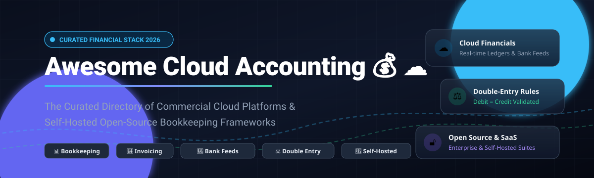

# Awesome-Cloud-Accounting

# Awesome-Cloud-Accounting 💰 ☁️

  

  

  

  

  

  

  

---

## 🌟 Top Cloud Accounting Ecosystem

**Curated List of Commercial Accounting Platforms & Open-Source Bookkeeping Frameworks**  

*Focused on Cloud Bookkeeping, Invoicing, Expense Tracking, Bank Reconciliation, Financial Reporting & Self-Hosted Accounting Suites*

**Last updated: October 2026** 📅

---

### 📌 Overview & SEO Summary

Welcome to the definitive directory of **cloud accounting platforms**, **open-source bookkeeping software**, **self-hosted double-entry general ledgers**, and **fintech billing frameworks**. Whether you are evaluating enterprise cloud ERP and commercial solutions (such as *Oracle NetSuite*, *QuickBooks Online*, *Xero*, and *Sage Intacct*) or self-hostable privacy-first open-source accounting platforms (such as *ERPNext*, *Firefly III*, *Invoice Ninja*, *Akaunting*, *GnuCash*, and *Bigcapital*), this curated guide covers category leaders, double-entry bookkeeping engines, automated bank feed reconciliations, and tax compliance infrastructure.

**Key Market & Search Insights:**

- **Dominant SMB Cloud Platforms:** **QuickBooks Online** and **Xero** lead global small-to-medium business accounting and bookkeeping automation.
- **Accessible Freemium Tiers:** **Zoho Books** and **Wave** deliver dedicated free tiers for freelancers, solopreneurs, and micro-businesses under specified revenue/usage caps.
- **Enterprise & Mid-Market Scale:** **Oracle NetSuite** and **Sage Intacct** power complex multi-entity consolidation, ASC 606 revenue recognition, and dimensional general ledger accounting.
- **Sovereign & Self-Hosted Accounting:** Self-hosted open-source solutions eliminate recurring SaaS fees, unlock full SQL audit trails, and guarantee financial data sovereignty for privacy-focused businesses.
- **Ecosystem Scale:** **ERPNext** leads open-source ERPs with over **40,000 GitHub_Stars**, **Firefly III** provides personal and small-business financial management with **24,800+ stars**, and **Invoice Ninja** and **Akaunting** offer self-hosted web platforms trusted by hundreds of thousands of active businesses.

---

## 📑 Table of Contents

- [🏢 SaaS & Commercial Platforms](#-saas--commercial-platforms)

- [🔓 Open-Source GitHub Projects](#-open-source-github-projects)

- [🛠️ How to Contribute](#%EF%B8%8F-how-to-contribute)

- [📊 Star History](#-star-history)

- [🤝 Support & Sponsorship](#-support--sponsorship)

- [⚠️ Disclaimer](#%EF%B8%8F-disclaimer)

---

## 🏢 SaaS / Commercial Platforms

The global accounting software market is valued at approximately **$22.5B–$25B** (projected to reach over $45B by the mid-2030s at an 8–10% CAGR) and remains **moderately fragmented** — anchored by dominant global ERP/SMB leaders like Oracle, Salesforce, Intuit, and Sage, while leaving considerable room for specialized cloud vendors and niche SME tools.

| SaaS / Commercial Platform | Company / Owner | Valuation / Market Cap | Standard Edition Starting Price | Free Tier / Free Trial Limits | Description |
| :--- | :--- | :--- | :--- | :--- | :--- |
| **[NetSuite](https://www.netsuite.com/)** 🔴 | Oracle | ~$300 Billion | **$999/month base + $99/user/month** | **No free trial** (Guided product tour & interactive demo only; minimum 10-user deployment) | **Full cloud ERP with core accounting** — Multi-entity consolidation, revenue recognition, inventory, CRM, and global tax compliance. Built for scaling mid-market and enterprise businesses. |
| **[Salesforce Accounting Subledger](https://www.salesforce.com/)** ☁️ | Salesforce | ~$250 Billion | **$165/user/month** (Enterprise CRM base required) | **30-day free trial** (Salesforce Enterprise trial with standard CRM limits and sample accounting data) | **CRM-native accounting subledger** — Prepares and summarizes transactional data for posting to any external ERP or general ledger; manages debit/credit balancing and financial schedules. |
| **[QuickBooks Online](https://quickbooks.intuit.com/)** 🟢 | Intuit | ~$200 Billion | **$38/month** (Simple Start plan) | **30-day free trial** (Full Simple Start tier features; limits to 1 billable user + 2 accounting seats) | **Most widely adopted SMB accounting software** — Bank feeds, automated categorization, receipt capture, invoicing, payroll add-on, and inventory tracking with native CPA collaboration. |
| **[Xero](https://www.xero.com/)** 🔵 | Xero | ~$15 Billion | **$25/month** (Early plan) | **30-day free trial** (Full feature access during trial; standard Early plan limits capped at 20 invoices and 5 bills/month) | **Integration-first cloud bookkeeping** — Beautiful interface, unlimited users on standard tiers, automated bank feeds via 1,000+ app marketplace connections, and Hubdoc document capture. |
| **[Zoho Books](https://www.zoho.com/books/)** 🟡 | Zoho Corporation | ~$12.5 Billion (Est.) | **$20/month** (Standard plan, 3 users) | **Free forever plan** (Strictly limited to 1 user + 1 accountant, up to 1,000 invoices/year, and businesses with annual revenue under $50,000) | **Best-value cloud accounting** — Robust invoicing, expense tracking, multi-currency support, customer portal, and automatic payment reminders at an accessible price point. |
| **[Sage Intacct](https://www.sageintacct.com/)** 🟣 | Sage Group | ~$10 Billion | **$9,000/year (~$750/month)** | **30-day product test drive** (Pre-configured sandbox environment with sample general ledger and reporting data) | **Mid-market financial management** — AICPA-preferred cloud financial management software featuring multi-entity consolidation, dimensional charts of accounts, and ASC 606 revenue automation. |
| **[Wave](https://www.waveapps.com/)** 🌊 | H&R Block | ~$5.2 Billion | **$16/month ($170/year)** (Pro plan) | **Free forever plan** (Starter tier: limited to 1 user seat, manual bank transaction imports only, manual receipt records, standard transaction fees) | **Browser-based accounting for micro-businesses** — Simple double-entry ledger, invoicing, and expense tracking tailored to freelancers, sole proprietors, and consultants. |
| **[FreshBooks](https://www.freshbooks.com/)** 🟠 | FreshBooks | ~$1.2 Billion | **$23/month** (Lite plan) | **30-day free trial** (Full platform functionality; Lite tier standard limits capped at 5 billable clients and 1 user seat) | **Invoicing-first bookkeeping suite** — Designed for freelancers and service agencies; features time tracking, mileage logging, project estimates, and client portal proposals. |
| **[Accounting Seed](https://www.accountingseed.com/)** 🌱 | Accounting Seed (H.I.G. Capital) | ~$100 Million (Est.) | **$250/month ($3,000/year starting)** | **No free trial** (1-on-1 personalized live demonstration and sandbox pilot with Salesforce architect) | **Salesforce-native accounting software** — Connects core sales pipelines with double-entry general ledger, subscription billing, and project accounting without external connectors. |
| **[Kashoo](https://kashoo.com/)** 🍁 | DataTax / Kashoo | ~$5 Million (Est.) | **$30/month ($216/year)** | **14-day free trial** (Full access to all features; paid plan supports unlimited users and unlimited invoicing) | **Simplified bookkeeping for non-accountants** — Smart inbox automation, OCR receipt matching, and basic sales tax tracking without complex accounting jargon. |

---

## 🔓 Open-Source GitHub Projects

*Curated self-hosted bookkeeping engines, plain-text accounting systems, invoicing tools, and double-entry ERP platforms. Sorted by GitHub_Stars_Count (descending).* 🌟

- **[ERPNext](https://github.com/frappe/erpnext)**   
  **Enterprise-grade open-source ERP with full double-entry accounting**, GPL-3.0 licensed. **40,000+ GitHub_Stars** — the premier open-source ERP suite. Complete multi-currency general ledger, automated bank reconciliation, tax rules, cost centers, asset management, and financial statement reporting. 🏢

- **[Firefly III](https://github.com/firefly-iii/firefly-iii)**   
  **Self-hosted double-entry financial manager**, AGPL-3.0 licensed. **24,800+ GitHub_Stars**. Provides automated transaction importing, budget management, rule-based categorization, multi-currency tracking, and detailed cash-flow analytics. 💰

- **[Invoice Ninja](https://github.com/invoiceninja/invoiceninja)**   
  **Self-hosted invoicing, quotes, and payment platform**, Elastic-2.0 licensed. **10,200+ GitHub_Stars**. Leading open-source billing engine built on Laravel and Flutter; supports client portals, recurring billing, automated payment gateway integration, and expense tracking. 🧾

- **[Akaunting](https://github.com/akaunting/akaunting)**   
  **Modern web-based small business accounting**, AGPL-3.0 licensed. **10,100+ GitHub_Stars** — deployed by over 300,000 small businesses. Self-hosted modular platform covering invoicing, bill payments, bank feeds, currency conversion, and financial health reporting. 🌐

- **[Ever Gauzy](https://github.com/ever-co/ever-gauzy)**   
  **Open enterprise management platform (ERP/CRM/HRM/PM)**, AGPL-3.0 licensed. **8,300+ GitHub_Stars**. Modular TypeScript/Node.js enterprise platform offering integrated bookkeeping, multi-organization invoicing, financial analytics, and payroll tracking. 🏢

- **[Beancount](https://github.com/beancount/beancount)**   
  **Double-entry accounting from plain text files**, GPL-2.0 licensed. **6,000+ GitHub_Stars**. Command-line and text-based double-entry ledger ecosystem written in Python, featuring extensible query syntax, Fava web UI integration, and rigorous balance verification. 📝

- **[Ledger](https://github.com/ledger/ledger)**   
  **The benchmark plain-text double-entry accounting system**, BSD-3-Clause licensed. **6,000+ GitHub_Stars**. High-performance C++ command-line tool that revolutionized command-line accounting with flexible ledger formatting, multicurrency support, and robust reporting. 💻

- **[ezBookkeeping](https://github.com/mayswind/ezbookkeeping)**   
  **Lightweight self-hosted personal & business bookkeeping application**, MIT licensed. **5,700+ GitHub_Stars**. Clean Go + Vue-based bookkeeping web app with multi-account support, multi-currency transactions, receipt management, and containerized Docker deployment. 📱

- **[GnuCash](https://github.com/Gnucash/gnucash)**   
  **Veteran free double-entry bookkeeping software**, GPL-2.0 licensed. **4,300+ GitHub_Stars**. The longest-running open-source double-entry system; supports bank reconciliation, checkbook registers, investment portfolio tracking, OFX/QIF bank imports, and scheduled transactions across desktop OSes. 📒

- **[Bigcapital](https://github.com/bigcapitalhq/bigcapital)**   
  **Open-source financial reporting & bookkeeping platform**, AGPL-3.0 licensed. **3,900+ GitHub_Stars**. Direct modern open-source alternative to QuickBooks and Wave. Includes Dockerized headless double-entry APIs, real-time balance sheets, automated reconciliations, and invoicing. 💵

- **[metasfresh](https://github.com/metasfresh/metasfresh)**   
  **Scalable open-source ERP for growing enterprises**, GPL-2.0 licensed. **2,400+ GitHub_Stars**. Enterprise Java and PostgreSQL-based architecture providing double-entry general ledger, automated procurement, invoicing, and order management. 📊

- **[Accountill](https://github.com/panshak/accountill)**   
  **Full-stack MERN invoicing & bookkeeping app**, MIT licensed. **1,600+ GitHub_Stars**. Built with MongoDB, Express, React, and Node.js. Provides customer account tracking, payment statuses, PDF invoice dispatch, and income statements. 📄

- **[erpsaas](https://github.com/andrewdwallo/erpsaas)**   
  **Laravel & Filament open-source accounting suite**, MIT licensed. **1,400+ GitHub_Stars**. Modern multi-tenant bookkeeping engine featuring customizable chart of accounts, tax reporting, automated invoicing, and clean administrative UI. 🎨

- **[django-ledger](https://github.com/arrobalytics/django-ledger)**   
  **Python Django double-entry financial analysis engine**, MIT licensed. **1,300+ GitHub_Stars**. Pluggable Django framework powering custom financial applications with automated balance sheets, income statements, and cash-flow ledgers. 🐍

- **[OpenBudgeteer](https://github.com/TheAxelander/OpenBudgeteer)**   
  **Bucket budgeting & expense tracking engine**, MIT licensed. **900+ GitHub_Stars**. Modern C# Blazor-based financial management software utilizing envelope and bucket budgeting principles. 💰

- **[Plutus](https://github.com/mbulat/plutus)**   
  **Ruby on Rails double-entry accounting engine**, MIT licensed. **700+ GitHub_Stars**. Pluggable Rails engine adding full double-entry accounting structures, debits, credits, and trial balance validation to web applications. 💎

- **[LedgerSMB](https://github.com/ledgersmb/LedgerSMB)**   
  **Open-source double-entry web accounting & ERP**, GPL-2.0 licensed. **500+ GitHub_Stars**. Robust web-based general ledger, inventory management, quotation, order tracking, and multi-currency accounting built on Perl and PostgreSQL. 🌐

- **[Midaz](https://github.com/LerianStudio/midaz)**   
  **Cloud-native multi-asset double-entry ledger platform**, Apache-2.0 licensed. **450+ GitHub_Stars**. High-throughput financial ledger engine for fintechs, banking rails, multi-currency transaction sequencing, and modern digital asset balances. ⚡

- **[Grisbi](https://github.com/Grisbi/grisbi)**   
  **Lightweight desktop accounting software**, GPL-2.0 licensed. **160+ GitHub_Stars**. Long-running European financial management software offering multi-currency accounts, direct budgetary lines, and financial reports. 🍷

- **[Bizuno](https://github.com/phreesoft/bizuno)**   
  **Self-hosted double-entry ERP/accounting for WordPress**, GPL-2.0 licensed. PhreeBooks successor providing double-entry general ledger, shipping carrier integrations, banking reconciliation, and multi-warehouse stock management. 📦

---

## 🛠️ How to Contribute

Contributions are welcome! Follow these steps to submit new cloud accounting platforms or open-source bookkeeping software:

1. 🍴 **Fork** the repository.

2. 📝 **Add/edit** entries in `README.md` maintaining table/list structure and formatting.

3. 🔗 Include project title, official website/GitHub link, exact Stars_Count, license, and brief description.

4. 🚀 Submit a **Pull Request** with a descriptive summary of your changes.

---

##  Star History

---

## 🤝 Support & Sponsorship

Thank you so much for exploring and using **Awesome-Cloud-Accounting**! Your support keeps this ecosystem alive, accurate, and continually updated with the best modern financial tooling.

If you find this repository valuable for your business, development, or accounting workflow, please consider supporting the project:

- ⭐ **Star** this repository to help others discover it and increase visibility!
- 🔀 **Fork** and share it with fellow accountants, developers, small business owners, and open-source advocates.
- ☕ **Buy Me a Coffee / Sponsor**: Support ongoing curation and research by visiting the [GitHub Sponsor Dashboard](https://github.com/sponsors/ishandutta2007). Every bit of support is deeply appreciated!

---

## ⚠️ Disclaimer

- This is a **community-curated** list — not exhaustive and not an endorsement. ℹ️

- **QuickBooks Online and Xero remain the dominant commercial platforms** — QuickBooks is the most widely used among accountants due to its feature set and collaboration capabilities . **Zoho Books offers the lowest entry price** with a free tier and Standard at $20/month .

- **Open-source accounting software eliminates subscription fees** but requires **technical expertise to deploy, back up, and maintain** . **GnuCash is desktop-only** — no multi-user web access . **Akaunting and Bigcapital require server setup** .

- **ERPNext provides the most complete open-source ERP** with **39,642 GitHub_Stars**, but **requires significant configuration** for accounting-specific workflows .

- **Always validate double-entry integrity, tax calculations, and financial reporting accuracy with a proof-of-concept** before production deployment. 📒

---

  <b>Made with ❤️ for accountants, small business owners, and open-source accounting advocates.</b>

